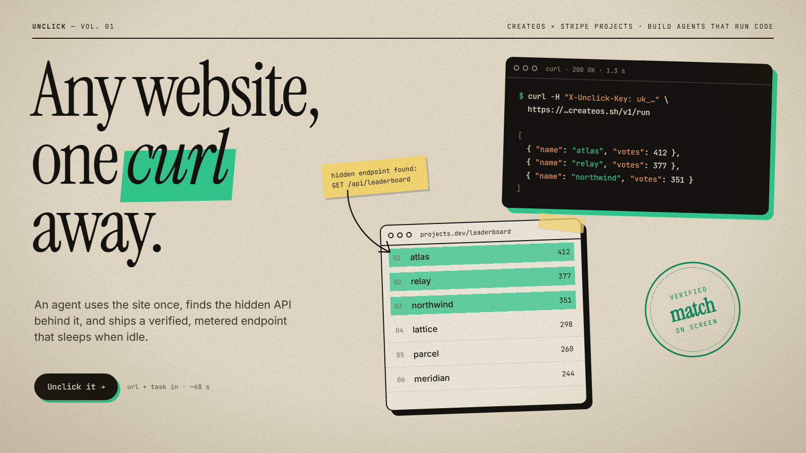
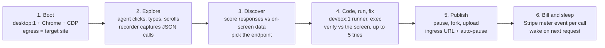
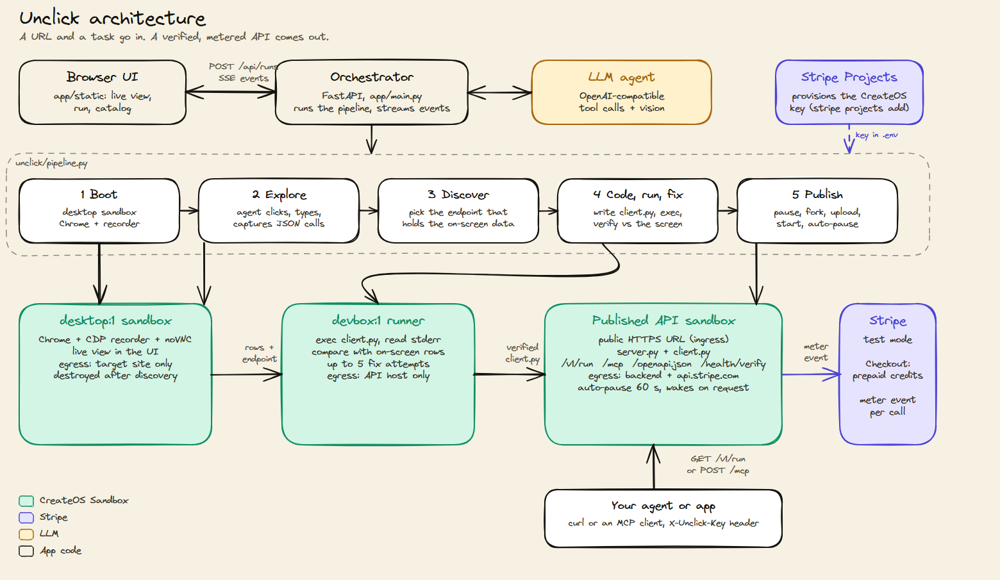

# Unclick

<div align="center">
  <a href="https://x.com/Maaztwts/status/2111607519365997033">
    
  </a>
  <h1>Unclick any website into an API</h1>
  <p>
    <b>Half the web has no API. Unclick finds the one hiding behind the page, writes the client, and proves it matches the screen.</b>
  </p>
  <p>
    An AI agent drives Chrome in a <b>CreateOS</b> desktop sandbox, captures the site's hidden JSON API, writes and fixes a Python client until it matches the screen, then ships it as a paid, auto-pausing API with a typed schema and an MCP endpoint.
  </p>
  <p>
    Built for the <b>CreateOS x Stripe Projects</b> hackathon, <i>"Build Agents That Run Code"</i> (Oct 17, 2026)
  </p>
  <p>
    
    
    
    
    
    
  </p>
  <p>
    <a href="https://x.com/Maaztwts/status/2111607519365997033">Demo Video on X</a> ·
    <a href="https://github.com/somewherelostt/unclick/issues">Report Bug</a> ·
    <a href="https://github.com/somewherelostt/unclick/issues">Request Feature</a>
  </p>
</div>

---

## Verified Live

On the real projects.dev leaderboard, one end-to-end run took **68 seconds**, and the published API returned **HTTP 200 in about 1.3 s**.

| Check | Result |
|---|---|
| `desktop:1` sandbox + Chrome + CDP capture | Verified live |
| Egress allowlist (set and update) | Verified live |
| Exec self-fix loop (`client.py` verified on attempt 2 in a real run) | Verified live |
| Ingress public URL (`/v1/run`, `/health`, `/docs`) | Verified live |
| Pause/resume + wake-on-request | Verified live (auto-paused after about 61 s, woke in about 6 s) |
| CreateOS provisioned through Stripe Projects | Verified live |
| Stripe test-mode billing (Checkout sessions + per-call meter events) | Live |
| MCP + OpenAPI + health verify | Verified in local mode (real OpenAI agent, Stripe test mode). On CreateOS they ship with the same `server.py`. |
| Fork into a tighter-policy API sandbox | Used when the plan allows it. On Free it is refused and falls back to a single sandbox. Not verified live. |

### Verified on 3 sites, each a different kind of API

Unclick is not tied to one site. Every API it publishes is **parameterized**: `client.run()` takes the site's real query parameters as typed arguments (search text `q`, `page`, `limit`, `sort`, filters), whose defaults reproduce exactly what was on screen. Unclick verifies the defaults against the screen, then calls `run()` once more with different values to prove the parameters change the data. Those parameters show up in `/openapi.json` and in the MCP tool's `inputSchema`, with descriptions.

| Site | Task | Hidden API found | Parameters of the published API | Verified in |
|---|---|---|---|---|
| [projects.dev/leaderboard](https://projects.dev/leaderboard) | Top projects with name, votes and URL, filterable by hackathon | `GET projects.dev/api/leaderboard` (same host) | `hackathon`, `limit` | Real CreateOS run (68 s) and local mode |
| [hn.algolia.com/?q=ai](https://hn.algolia.com/?q=ai) | Search Hacker News stories: title, points, URL | `POST *.algolia.net/1/indexes/Item_dev/query` (a different host) | `q`, `page`, `limit` | Local mode |
| [crates.io/search?q=http](https://crates.io/search?q=http) | Search Rust crates: name, downloads, description | `GET crates.io/api/v1/crates` | `q`, `page`, `limit`, `sort` | Local mode |

*Local mode* (`UNCLICK_SANDBOX=local`) is the same pipeline and the same real LLM agent, with local Chrome and local processes instead of CreateOS sandboxes (no egress, fork or auto-pause enforcement). The HN and crates.io runs used local mode to save the CreateOS sandbox quota for the recorded run. Each local run published a working API: for example `?q=tokio&sort=downloads&limit=3` on the crates.io API returned `mio`, `tokio`, `rustls`.

## The "Why" (Our Story)

Half the web has no API. The data is right there on the screen, so a human can read it, but a developer can't call it.

Scraping HTML breaks every time the markup changes. Yet most modern sites fetch that data from a **hidden JSON API** that the page calls itself. It is rarely documented, and the only way to find it is to open DevTools and read network traffic.

**A motivating example: flights.** Say you want today's fares for a route across a few airline sites. There is no API, so you re-fill the same search forms every time. A browser agent can do it for you, but it is slow and flaky, and you pay for it on every single check. What you really want is an endpoint like:

```bash
GET /v1/run?from=BLR&to=SFO&date=2026-11-02
```

That is the shape of API Unclick is built to produce: do the search once, and get a plain HTTP call back. This is an illustration of the problem, not something we have run on a specific airline. Many airline sites use anti-bot protection, which Unclick does not bypass. The verified sites are listed above (projects.dev, HN search, crates.io).

**We built Unclick because we wanted that step to disappear.** You give it a URL and a task. An agent does the task once, in a real browser, finds the hidden API, and hands you back a `curl` command that returns clean JSON in about a second, with no LLM in the request path.

## What It Does

You give it a URL and a task, for example `https://hn.algolia.com/?q=ai` and "Search Hacker News stories: title, points, url". Then:

- **Does the task once, live.** An AI agent works in a real Chrome browser inside a [CreateOS](https://createos.sh) `desktop:1` sandbox. You watch it over noVNC.
- **Finds the hidden API.** A CDP recorder captures every JSON call the page makes. The pipeline picks the endpoint whose response actually contains the data that was on screen.
- **Writes, runs and fixes a client.** The agent writes a Python client for that endpoint, runs it in a second sandbox, reads the traceback or the diff, and fixes it until its output matches what the browser showed.
- **Turns it into a real API, not a snapshot.** The client exposes the site's own query parameters (`q`, `page`, `sort`, filters) as typed arguments, so one run gives you a general search/list API for that site: `GET /v1/run?q=rust&page=2`.
- **Publishes it as a paid API.** The verified client becomes an HTTPS API on the sandbox's public URL. Each call is billed in **Stripe test mode**, and the sandbox **auto-pauses** when idle and wakes on the next request.

### The app

The web UI has a warm editorial look. When a run finishes, a **Live** card shows the API with **curl**, **MCP** and **Schema** tabs. A **Catalog** view lists every published API, with **Verify** and **Self-heal** buttons for each one.

## One API Call Instead of a Hundred Clicks

A browser agent that reads a site has to open the page, look at it and click through it **every time you need the data**. Each run pays for a browser, a model and a lot of waiting.

Unclick pays that price **once**.

| | Browser agent, every time | Unclick |
|---|---|---|
| **First run** | Browser + LLM clicking through the page (a minute or more) | Browser + LLM clicking through the page: **~68 s** end to end, including writing, verifying and publishing the client |
| **Every run after that** | The same browser + LLM again | One plain HTTP call: **~1.3 s**, no LLM and no browser in the request path |
| **What you get back** | Whatever the agent decided to say | The site's own JSON, through a client verified against the screen |

```bash
curl -H "X-Unclick-Key: uk_..." https://<id>-8000.app.sb.createos.sh/v1/run
```

The 68 s and 1.3 s figures come from a real run on the projects.dev leaderboard (see Verified Live above).

## How Unclick Compares

| | **Unclick** | **HTML scraping** | **Browser agents** (headless / computer use) | **RPA** |
|---|---|---|---|---|
| **Speed per call** | ~1.3 s measured (one HTTP call) | Fast to fetch, but you parse HTML yourself | Slow: renders and drives the page every time | Slow: replays UI steps every time |
| **Cost per call** | A prepaid credit ($5 per 100 calls in test mode), no model tokens | Cheap compute, plus your time maintaining selectors | A browser plus model tokens on every call | A runner or license, plus a browser |
| **Breaks when the markup changes?** | No, it reads the JSON the page itself calls. It can still break if that API changes, which is what the health check and self-heal are for. | Yes, often | Less often, but flaky | Yes, when the UI changes |
| **Needs an LLM per call?** | No, only once at build time | No | Yes | No |
| **Setup effort** | A URL and a task | Write and maintain selectors per site | Write a prompt, then pay for it each time | Record and maintain a flow |
| **Output** | Typed JSON | HTML you have to parse | Free text or whatever the agent returns | Screen data or files |

## Use Cases

Unclick fits any public page that loads its data from a JSON endpoint. The first two bullets have been run end to end (see "Verified on 3 sites" above). The rest are what the same pipeline is built for.

- **Search any site from code.** Hacker News search (`?q=`, `page`) and crates.io search (`?q=`, `sort`, `page`) became typed search APIs in one run each.
- **Public leaderboards and directories.** The projects.dev leaderboard became an API with a `hackathon` filter.
- **E-commerce prices and catalogs.** Turn a product listing page into a price feed.
- **Real-estate listings.** Pull listings from a search page as structured rows.
- **Job boards.** Get new postings as JSON instead of copying them by hand.
- **Travel availability.** Read availability and fares that a booking page loads in the background.
- **Typed tools for AI agents.** Give an agent a small HTTP API with a known shape, instead of making it drive a browser on every task. Each published API also serves an MCP endpoint and an OpenAPI schema for this.

## Speed and Cost

- **No headless browser per call.** The published API talks straight to the site's own JSON endpoint, from a small stdlib-only Python server.
- **No model in the request path.** The LLM writes and fixes the client once at build time. After that, a call is plain code.
- **Pay per call through Stripe (test mode).** $5 buys 100 calls as prepaid credits, and each successful call also records a Billing Meter event.
- **Idle is close to free.** The API sandbox auto-pauses after 60 s of inactivity and wakes on the next request (about 6 s in our live check).

## Reliability and Safety

- **A self-fix loop at build time.** The agent's client is run and compared with the rows that were on screen. A crash, wrong JSON or a hard-coded value goes back to the agent with the error and the diff, for up to 5 attempts.
- **Egress allowlists.** The desktop is locked to the target site, the runner to the API host, and the published API to `[backend host, api.stripe.com]`. It can't call anything else.
- **Sandbox isolation per run.** Every run gets its own CreateOS sandboxes, and the desktop one is destroyed once the endpoint is found.
- **Test-mode billing only.** Only `sk_test_` / `rk_test_` Stripe keys are accepted, and live keys are refused.
- **What we do not do.** Unclick does **not** bypass CAPTCHAs, anti-bot measures or paywalls. It is meant for public data. Sites behind a login are not supported yet, and using your own session is on the Roadmap.

## How It Works



| # | Phase | What happens | Code |
|---|---|---|---|
| 1 | **Boot** | A `desktop:1` sandbox starts with ingress on. Chrome launches with the DevTools protocol, and the network recorder starts. Egress is locked to the target site (`host`, `*.base`). | `unclick/desktop.py`, `unclick/pipeline.py` |
| 2 | **Explore** | The agent gets a screenshot, the page text, a list of clickable controls and a list of captured JSON calls. It then clicks, types, scrolls or picks a dropdown option. The pipeline refuses `done` (up to 3 times) until a captured JSON response really contains the on-screen data. If the page tried to call a host that egress blocks, exactly that host is added to the allowlist. | `unclick/pipeline.py`, `unclick/agent.py` |
| 3 | **Discover** | Captured JSON responses are scored by how many on-screen tokens they contain and filtered for noise (analytics, auth, feature flags). The model picks the endpoint from the top candidates, and the pipeline reads ground truth (the rows) off the screen. | `unclick/pipeline.py` |
| 4 | **Code, run, fix** | The desktop sandbox is destroyed. A `devbox:1` runner starts with egress locked to the API host. The agent writes `client.py`, the pipeline runs it with `exec`, and `verify_output` compares the stdout with the on-screen rows (numbers may drift a little on live sites). A crash, wrong JSON or a hard-coded value triggers a fix prompt with the stderr and the diff. Up to 5 attempts. | `unclick/pipeline.py`, `unclick/agent.py` |
| 5 | **Publish** | The verified sandbox is paused and forked (when the plan allows it) into an API sandbox with egress `[backend host, api.stripe.com]` and ingress on. A stdlib-only HTTP server and `client.py` are uploaded and started. `auto_pause_after_seconds=60` is set. | `unclick/publish.py`, `unclick/api_template/server.py` |
| 6 | **Bill and sleep** | Each successful call decrements prepaid credits and records a Stripe Billing Meter event. When idle, the sandbox auto-pauses, and the next request wakes it. | `unclick/billing.py`, `unclick/api_template/server.py` |

### Architecture

<div align="center">
  
  <p><em>Editable source: <a href="docs/architecture.excalidraw">docs/architecture.excalidraw</a> (open it at <a href="https://excalidraw.com">excalidraw.com</a>)</em></p>
</div>

All progress goes through one `EventSink.emit(kind, message, **data)` contract ([unclick/contracts.py](unclick/contracts.py)). The UI is a pure renderer of those events, which is also why the scripted demo and replay modes work.

## The CreateOS & Stripe Experience

Unclick is built on the hackathon's two sponsor technologies, and each one does a real job.

### CreateOS Sandbox: the runtime for an agent that runs code

| Feature | Where it is used | Status |
|---|---|---|
| **`desktop:1` image + noVNC live view** | `create_desktop()` in [unclick/desktop.py](unclick/desktop.py) boots the sandbox, starts Chrome and gets the noVNC URL from the computer API (`/screens/screen-0/connect`). The UI embeds it in an iframe. Clicks, typing and screenshots also use the computer API. | Verified live (boot, Chrome, recorder, explore) |
| **Egress allowlist** | The desktop starts locked to the target site. `_allow_host()` in [unclick/pipeline.py](unclick/pipeline.py) adds a host live when the page's fetch is blocked, or when the picked API lives on another host. The runner is locked to the API host. The published API is locked to `[backend host, api.stripe.com]`. | Verified live for set/update. On projects.dev the API is on the same host, so no host is *added* in that demo (see Limitations). |
| **Exec self-fix loop** | The runner uses `sandbox.exec` to run `client.py` and returns stdout, stderr and the exit code to the agent, which patches the code. See `run()` in [unclick/pipeline.py](unclick/pipeline.py). | Verified live: client verified on attempt 2 in a real run |
| **Fork** | `publish()` pauses the verified sandbox, then `fork(egress=..., ingress=True)` creates the API sandbox with the same warm state and a tighter policy. | Used when the plan allows it (Beginner or higher). On Free, the fork is refused (concurrent quota 1), and it falls back to publishing in the single sandbox. **Not yet verified live.** |
| **Ingress public URL** | `enable_ingress()` and `preview_url(8000)` give `https://<id>-8000.app.sb.createos.sh`, which serves `/v1/run`, `/health` and `/docs`. | Verified live |
| **Pause/resume + wake-on-request** | `set_auto_pause(60)` is set at publish. The next request to the URL wakes the sandbox, and `wake_and_time()` measures the latency. | Verified live: auto-paused after about 61 s, woke in about 6 s |

### Stripe Projects: provisioning from the terminal

CreateOS is provisioned through **Stripe Projects**, not by hand:

```bash
stripe projects init unclick
stripe projects add createos/free        # or createos/project
stripe projects env --pull               # writes the credentials to .env
```

The app prefers the key Projects issues (`CREATEOS_PROJECT_API_KEY`) and falls back to `CREATEOS_SANDBOX_API_KEY` / `CREATEOS_API_KEY`. The optional LLM path comes from `openrouter/api` (OpenAI-compatible, so set `LLM_BASE_URL=https://openrouter.ai/api/v1`). We share the stack on the projects.dev leaderboard with `stripe projects share`. See [docs/stripe-projects.md](docs/stripe-projects.md) for the setup notes.

### Stripe test-mode billing: the API is a product

Billing lives in [unclick/billing.py](unclick/billing.py) and [unclick/api_template/server.py](unclick/api_template/server.py):

- A Stripe **Price** ($5 for 100 calls by default) and a **Billing Meter** (`unclick_api_call`) are created on first use. Both are idempotent.
- **Buy 100 calls** in the UI opens a Stripe **Checkout** session in test mode. After a verified payment, the app issues an API key `uk_<customer id>_<hex>`. Only a SHA-256 of the key is stored, in the Stripe Customer's metadata.
- Every successful call to `/v1/run` uses one credit and sends a **meter event** to Stripe from inside the sandbox. This happens on a background thread, so the response isn't slowed down. Failed client calls are refunded, not charged. Out of credits returns **HTTP 402** with a buy link.
- Only `sk_test_` / `rk_test_` keys are accepted, and live keys are refused. No real money moves.
- A free **demo key** is issued at publish time so the live demo never blocks. Its calls are still metered to a shared demo customer.

## What Every Published API Gets

Each published API runs in its own sandbox and serves these endpoints. The MCP, OpenAPI and health-verify rows were verified in local mode with the real agent and Stripe test mode. On CreateOS they ship with the same `server.py`.

| Endpoint | What it does | Status |
|---|---|---|
| `GET /v1/run` | Runs the verified client and returns the JSON. Needs the `X-Unclick-Key` header and uses one credit. | Verified live |
| `GET /health` | Liveness check. | Verified live |
| `GET /docs` | Interactive docs for the API. | Verified live |
| `GET /openapi.json` | A **typed OpenAPI 3.1 schema**: the query parameters come from `client.run()`'s signature (type, default, description, example), the response schema is inferred from the verified output (for example `{name: string, votes: integer, url: uri}`). | Verified (local mode) |
| `POST /mcp` | A per-API **MCP server** (Streamable HTTP: `initialize`, `tools/list`, `tools/call`). The tool is named after the API, for example `get_projects_dev_leaderboard`. | Verified (local mode, with the official MCP Inspector CLI) |
| `GET /health/verify` | A **health check**: re-runs the client and validates the output against the schema (79 rows in about 330 ms in our check). | Verified (local mode) |

The orchestrator adds two endpoints of its own:

| Endpoint | What it does | Status |
|---|---|---|
| `GET /api/catalog` | The **API catalog** of published APIs. | Verified (local mode) |
| `POST /api/apis/{id}/verify` | Runs the health check for one published API. | Verified (local mode) |
| `POST /api/apis/{id}/heal` | **Self-heal:** re-runs the agent pipeline against the site if verify fails. | Verified (local mode) |

### Use as a tool in Claude / Cursor (MCP)

Every published API can act as an MCP server at `POST /mcp`, so an agent can call it as a typed tool instead of driving a browser. Add it to Claude Desktop, Cursor or any MCP client with a config like this:

```json
{
  "mcpServers": {
    "<name>": {
      "url": "<api-host>/mcp",
      "headers": { "X-Unclick-Key": "<key>" }
    }
  }
}
```

Replace `<name>` with anything you like, `<api-host>` with your API's public URL (for example `https://<id>-8000.app.sb.createos.sh`), and `<key>` with your Unclick API key.

## Getting Started

### Prerequisites

- Python 3.12+
- The [Stripe CLI](https://docs.stripe.com/stripe-cli) with the Projects plugin (`stripe plugin install projects`)
- An LLM key with vision and tool calling (OpenAI, or OpenRouter through Stripe Projects)
- A Stripe account in **test mode** (free, no activation needed)

### Installation

1. **Clone the repo**

   ```bash
   git clone https://github.com/somewherelostt/unclick.git
   cd unclick
   ```

2. **Install dependencies**

   ```bash
   pip install -r requirements.txt
   ```

3. **Provision CreateOS with Stripe Projects**

   ```bash
   stripe projects init unclick
   stripe projects add createos/free
   stripe projects env --pull
   ```

4. **Set up environment variables**
   Copy `.env.example` to `.env` and fill in your keys (never commit `.env`):

   ```bash
   cp .env.example .env
   ```

   **Required keys:**
   - `CREATEOS_PROJECT_API_KEY` or `CREATEOS_SANDBOX_API_KEY`: written by Stripe Projects, or from the [CreateOS dashboard](https://createos.sh/app/profile)
   - `OPENAI_API_KEY`: the agent's LLM (or an OpenRouter key plus `LLM_BASE_URL`)
   - `STRIPE_SECRET_KEY`, `STRIPE_PUBLISHABLE_KEY`: Stripe **test** keys. Without them, the API runs unmetered with a local demo key.

### Running the App

```bash
uvicorn app.main:app --port 8080
```

Open http://localhost:8080, keep the default URL and task, and press **Unclick it**. When it finishes, copy the `curl` command from the result panel.

**Command line (no UI):**

```bash
python scripts/run_agent.py                      # real run on projects.dev/leaderboard
python scripts/run_agent.py --fake --scripted    # fully offline
```

### Run Modes

The header badge in the UI always says which mode is running.

| Mode | Command | What is real |
|---|---|---|
| **Real** (default) | `uvicorn app.main:app --port 8080` | CreateOS sandboxes, the real LLM agent, Stripe test mode |
| **Local sandbox** | `UNCLICK_SANDBOX=local uvicorn app.main:app --port 8080` | The real agent, with local Chrome and local processes instead of CreateOS |
| **Scripted demo** | `UNCLICK_FAKE=1 uvicorn app.main:app --port 8080` | Nothing. A scripted run of about 75 seconds (`UNCLICK_FAKE_SPEED=4` makes it 4x faster) that exercises every part of the UI. No keys needed. The sandboxes, data and charge are **simulated**. |
| **Replay** | `UNCLICK_REPLAY=runs/<name>.jsonl uvicorn app.main:app --port 8080` | A recorded run, re-emitted with its original timing. Or open `/?replay=<name>&speed=2`. |

Every run is recorded to `runs/<run_id>.jsonl`, which is what replay plays back. On PowerShell, set variables first: `$env:UNCLICK_FAKE="1"; uvicorn app.main:app --port 8080`.

### Environment Variables

| Variable | Purpose |
|---|---|
| `CREATEOS_PROJECT_API_KEY` | CreateOS key from Stripe Projects (preferred) |
| `CREATEOS_SANDBOX_API_KEY` / `CREATEOS_API_KEY` | CreateOS sandbox key from the dashboard (fallback) |
| `CREATEOS_SANDBOX_BASE_URL` | defaults to `https://api-eu.sb.createos.sh` |
| `OPENAI_API_KEY`, `LLM_MODEL`, `LLM_BASE_URL` | the agent's LLM (default `gpt-4.1`, needs vision and tool calling; optional OpenRouter base URL) |
| `STRIPE_SECRET_KEY`, `STRIPE_PUBLISHABLE_KEY` | Stripe **test** keys |
| `PUBLIC_BASE_URL` | public URL of the orchestrator, used for Checkout redirects |
| `UNCLICK_FORK=0` | skip the fork attempt (saves about 7 s on the Free plan) |
| `UNCLICK_SANDBOX=local` | local sandbox mode |
| `UNCLICK_FAKE=1` | scripted demo mode |
| `UNCLICK_REPLAY`, `UNCLICK_REPLAY_SPEED` | replay a recording from `runs/` |

### Plans and limits

The Free CreateOS plan allows 1 concurrent sandbox and 10 sandboxes per day. Fork needs a second sandbox, and a desktop wants more than 1 vCPU, so use the **Beginner** plan (5 concurrent) for the full flow.

## Tech Stack

### Sandbox & Infrastructure

- **Runtime**: [CreateOS Sandbox](https://createos.sh): `desktop:1` and `devbox:1` microVMs, noVNC, egress allowlists, fork, ingress URLs, pause/resume with wake-on-request
- **Provisioning**: [Stripe Projects](https://docs.stripe.com/projects) (`createos/free`, `createos/project`, optional `openrouter/api`)
- **Browser capture**: Chrome DevTools Protocol network recorder

### Backend (`app/`, `unclick/`)

- **Language**: Python 3.12
- **Framework**: [FastAPI](https://fastapi.tiangolo.com/) + Server-Sent Events
- **HTTP**: [httpx](https://www.python-httpx.org/), [pydantic](https://docs.pydantic.dev/)
- **LLM**: OpenAI-compatible tool calling and vision (OpenAI directly, or OpenRouter)
- **Published API server**: stdlib-only Python (no pip, no extra egress)

### Billing

- **Stripe test mode**: Checkout, Customers, Prices, Billing Meters

### Frontend (`app/static/`)

- Vanilla JS + [Tailwind](https://tailwindcss.com/)

## Project Structure

```text
unclick/
├── app/
│   ├── main.py                  # FastAPI orchestrator: runs, SSE events, record/replay
│   ├── fake_pipeline.py         # Scripted demo (UNCLICK_FAKE=1)
│   └── static/                  # Browser UI (vanilla JS + Tailwind)
├── unclick/
│   ├── contracts.py             # EventSink contract
│   ├── pipeline.py              # boot → explore → discover → code/verify → publish
│   ├── agent.py, prompts.py     # LLM agent: tool calls + vision
│   ├── sandbox.py, desktop.py   # CreateOS REST client, Chrome + CDP + noVNC
│   ├── publish.py               # pause → fork → upload → start
│   ├── billing.py               # Stripe Checkout, Price, Meter, usage
│   ├── fakes.py                 # Local sandbox + simulated modes
│   ├── sandbox_assets/          # CDP recorder uploaded to the desktop
│   └── api_template/            # server.py: stdlib API that runs in the published sandbox
├── scripts/                     # run_agent.py, smoke tests
├── runs/                        # Recorded runs (.jsonl), used by replay
├── docs/                        # PLAN.md, DEMO_SCRIPT.md, SUBMISSION.md, research notes
└── requirements.txt
```

## Hackathon Context

- **Launch post and demo video**: [our post on X](https://x.com/Maaztwts/status/2111607519365997033).
- **Event**: CreateOS x Stripe Projects, **"Build Agents That Run Code"**.
- **Challenge**: Build an agent that writes code, runs it in a sandbox, reads the errors and fixes itself.
- **Tools Used**:
  - **CreateOS Sandbox**: the desktop, the exec loop, egress control, fork, ingress and pause/wake.
  - **Stripe Projects**: provisioning CreateOS from the terminal.
  - **Stripe**: test-mode Checkout and metered billing for the published API.

## Limitations

Honest notes:

- **Public data only.** Unclick doesn't bypass CAPTCHAs, bot detection or paywalls. The verified sites are public pages, and we send very few requests.
- **Server-rendered sites with no JSON API aren't supported yet.** If the page never fetches its data as JSON, there is no hidden API to find. In local tests, TrustMRR and the YC company directory failed this way (on TrustMRR the only JSON call was a sponsors list, not the listings).
- **projects.dev/leaderboard is server-rendered.** Its JSON API (`/api/leaderboard`) fires only when the "filter by hackathon" dropdown changes, so the agent has to change the filter and then restore it. The API is on the same host, so the live "host added to egress" moment appears only on sites whose API lives on another host.
- **Fork is not verified live.** It has been exercised offline, and live on Free it is refused (quota) and falls back to a single sandbox.
- Computer use can be flaky, and the agent can fail on sites with heavy client-side state or login walls.
- The published API runs one generated client. Parameters beyond what the client's `run(**params)` accepts aren't inferred automatically.
- The scripted mode (`UNCLICK_FAKE=1`) is simulated and is labelled as such in the UI.

## Roadmap

Everything below is **future work**. None of it is built yet.

- [ ] **Scheduled health checks.** Run the health check on a schedule, so a broken API is noticed and healed without anyone asking.
- [ ] **POST and action endpoints.** Form submits, bookings and other actions, not just reads.
- [ ] **Authenticated APIs.** Use your own login session for pages behind a sign-in.
- [ ] **A shared catalog.** Let people fork and improve each other's published APIs.
- [ ] **Scheduled monitoring.** Alerts for price drops, new listings and similar changes.
- [ ] Verify the fork path live on a paid CreateOS plan.
- [ ] Infer request parameters (pagination, filters) into the generated client.

## FAQ

**Is this scraping?**
Not in the HTML sense. Unclick doesn't parse markup. It finds the JSON endpoint the page itself calls, and calls it with a small verified client.

**Is it legal and respectful?**
We can't give legal advice, so check the terms of any site you point it at. Unclick is built for public data, sends very few requests, and doesn't bypass CAPTCHAs, anti-bot measures or paywalls.

**What happens when the site changes?**
A health check (`GET /health/verify`) re-runs the client and validates it against the schema, and self-heal (`POST /api/apis/{id}/heal` on the orchestrator) re-runs the agent pipeline if verify fails. Running either one automatically on a schedule is on the Roadmap. Because the client reads JSON and not HTML, cosmetic changes to the page don't affect it.

**Why sandboxes?**
The agent drives a real browser and runs code it wrote itself. A CreateOS sandbox keeps that contained, with an egress allowlist so it can only reach the sites it needs. The published API also runs in one, which is what lets it pause when idle and wake on request.

**What does Stripe do here?**
Stripe Projects provisions CreateOS from the terminal. Stripe test mode turns the API into a product: Checkout sells prepaid credits, and each successful call records a Billing Meter event. No real money moves.

**Can I run it locally?**
Yes. `pip install -r requirements.txt`, copy `.env.example` to `.env`, and run `uvicorn app.main:app --port 8080`. `UNCLICK_SANDBOX=local` uses local Chrome instead of CreateOS, and `UNCLICK_FAKE=1` is a scripted demo that needs no keys. See [Run Modes](#run-modes).

## The Team

**Team name: Cold Coffee**

| Name | GitHub |
|---|---|
| **Maaz** | [somewherelostt](https://github.com/somewherelostt) |
| **Ananya** | [isthatananya](https://github.com/isthatananya) |

## License

Released under the MIT License.

---

<div align="center">
  Made by <b>Cold Coffee</b> (<b>Maaz</b> & <b>Ananya</b>) for the CreateOS x Stripe Projects hackathon
</div>
